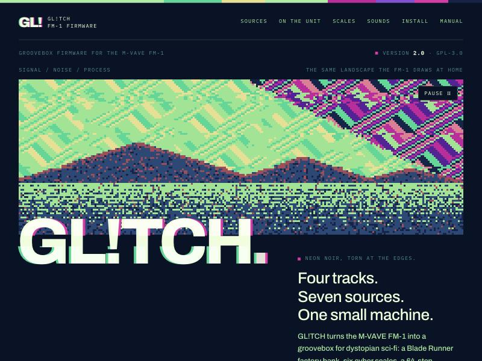
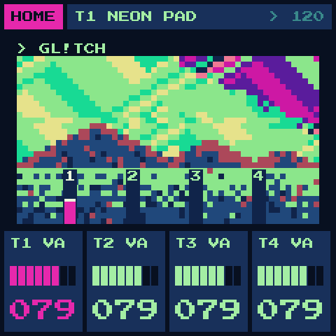
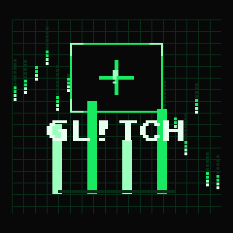
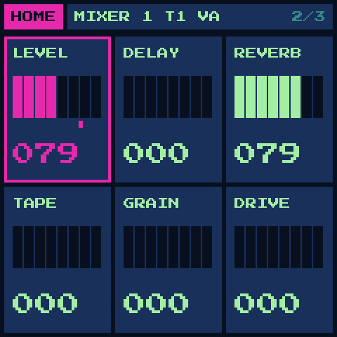
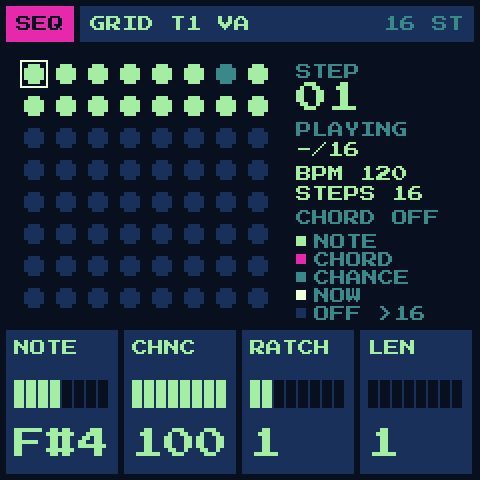
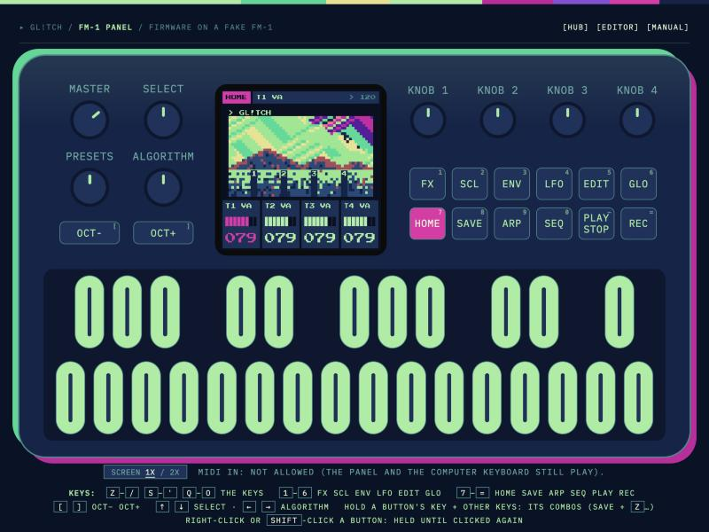
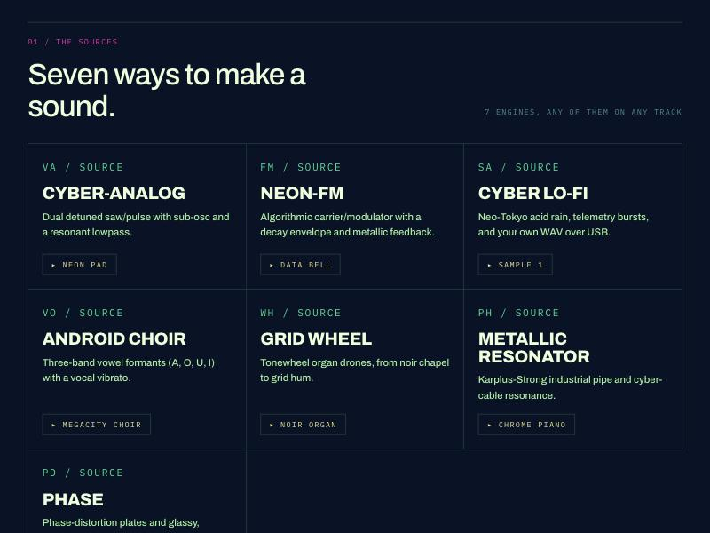
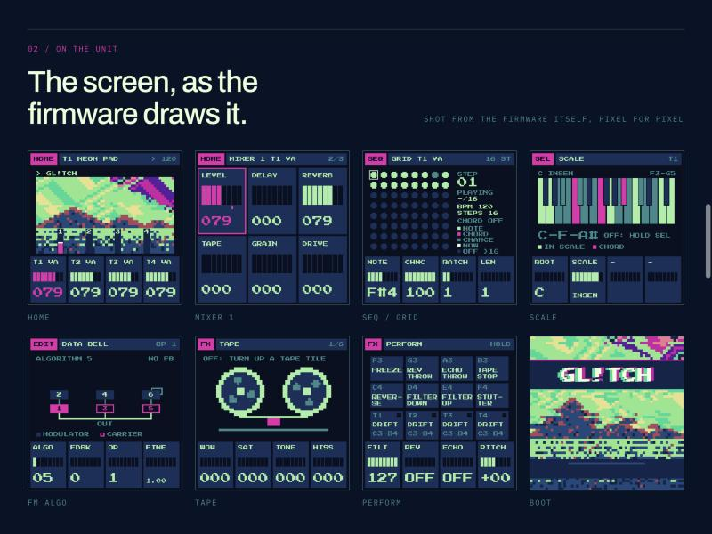
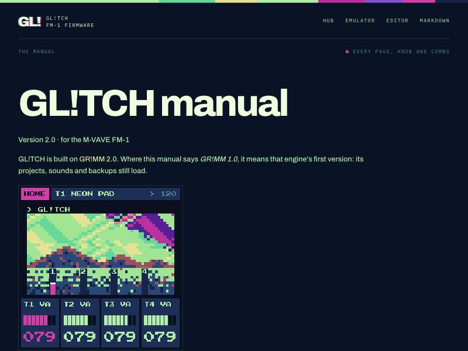

# GL!TCH

**A neon-noir groovebox firmware for the M-VAVE FM-1.** Blade Runner factory sounds, six cyber scales, four tracks and
seven sources, tape and megacity space — under a glitched sky.

> **Version 2.0.** Tested on a real FM-1: the release installed from another firmware, left again, and installed back
> ([the results](docs/TEST-RESULTS-2.0.md), and what they do not cover). Unofficial firmware, not made or endorsed by
> M-VAVE: install at your own risk.
> Based on [GR!MM](https://github.com/GRiMMBIENT/grimm) (see [Credits](#credits)).

**[The GL!TCH hub](https://saulofilho.github.io/glitch/)**: the sources, scales and sounds, and how to install ·
**[Boot it in your browser](https://saulofilho.github.io/glitch/emu/)** (the real firmware, no FM-1 needed) ·
**[The editor](https://saulofilho.github.io/glitch/emu/editor.html)** (sounds, samples, backup over USB)

[](https://saulofilho.github.io/glitch/)

Free and open source (GPL-3.0). Re-imagined from GR!MM's dark-ambient/dungeon-synth aesthetic into cyberpunk, neon
noir and industrial sci-fi.

## On the unit

HOME and the boot screen are a glitched landscape: a sky in mint, teal and lemon bands torn to pink and violet, navy
hills, a striped plain. Its bands drift and its rows tear sideways the louder it plays. Every screen below is shot
from the firmware itself (`tools/gen_screens.py`).

| HOME | Boot | MIXER 1 | SEQ |
| :---: | :---: | :---: | :---: |
|  |  |  |  |

## What's inside

- **Seven sources**: **Cyber-Analog** (VA — dual detuned saw/pulse, sub-osc, resonant lowpass), **Neon-FM**
  (algorithmic carrier/modulator with metallic feedback), **Cyber Lo-Fi** (SAMPLE — acid rain, telemetry, your own
  WAV over USB), **Android Choir** (VOICE — 3-band vowel formants), **Grid Wheel** (tonewheel drones), **Metallic
  Resonator** (PHYS — Karplus-Strong pipe and cable), and **Phase** (phase-distortion plates and glitch leads).
- **Sixteen scales**: Chromatic, Aeolian, Major, **Cyber Dorian**, Phrygian, Lydian, Mixolydian, Locrian, Harmonic
  Minor, **Phrygian Dominant**, **Iwato**, **Whole Tone**, **Noir Pentatonic**, Major Pentatonic, **Insen**,
  **Hirajoshi**. The keys snap to the scale; hold a key for its one-key chord.
- **Forty-four factory sounds** across nine categories — DRONE, PAD, BELL, ORGAN, KEYS, BASS, TEXTURE, VOICE, OTHER:
  NEON PAD, RAIN VEIL, ICE HALL, CITY ABYSS, DATA BELL, PIPE GONG, ANDROID GHOST, MEGACITY CHOIR, NOIR ORGAN, CHROME
  PIANO, CS80 BRASS, GLITCH LEAD, ACID RAIN…
- **From GR!MM**: 4 tracks, a 64-step sequencer per track with swing, chance and ratchets, song mode, arpeggiator,
  one-key chords, GENERATE, tape, grain, delay, and megacity space reverb (6 combs + 3 allpass + infinite freeze),
  MIDI in.

## Architecture: GR!MM → GL!TCH

| Feature | GR!MM (Original) | GL!TCH (Cyberpunk Edition) |
| :--- | :--- | :--- |
| **Aesthetic** | Dark Ambient, Dungeon Synth, Deathdream | Neon Noir, Cyberdeck, Blade Runner, Darksynth |
| **Tracks** | 4 independent tracks | 4 independent tracks (Sub/Bass, Lead, Choir/Pad, Glitch) |
| **Analog Engine** | Organ & Low-fi Saw Drones | **Cyber-Analog:** Dual detuned saw/pulse with sub-osc & resonant lowpass |
| **FM Engine** | 6-Operator FM Bells & Metals | **Neon-FM:** Algorithmic carrier/modulator with decay envelope & metallic feedback |
| **Physical Model** | String / Primitive Acoustic Pipe | **Metallic Resonator:** Karplus-Strong industrial pipe & cyber-cable resonator |
| **Vocal Engine** | Gregorian Chants & Murmurs | **Android Choir:** 3-band vowel formant filters ([A], [O], [U], [I]) with vocal vibrato |
| **Sampler / Lo-Fi** | Recorded Choirs & Cassette Noise | **Cyber Lo-Fi:** Neo-Tokyo acid rain, telemetry bursts, and custom WAV over USB |
| **Space Reverb** | Infinite cavern reverb | **Megacity Space Reverb:** 6 comb filters + 3 allpass diffusers + infinite freeze toggle |
| **Sequencer** | 64 steps, self-playing modes | **64 steps, ratchets (1×–4×), probability, swing, and a generative engine** |
| **Scales** | Phrygian, Dorian, Harmonic Minor | **Insen, Hirajoshi, Phrygian Dominant, Cyber Dorian, Iwato, Whole Tone** |

## Try it in the browser

The emulator is `firmware/src/grimm.c` itself — the code the FM-1 runs — compiled to WebAssembly and played on a fake
FM-1 (`firmware/src/fm1_web.c`). No hardware needed.

```bash
python3 -m http.server 8080
```

- **`http://localhost:8080/hub/`** — the hub: the sources (with a teaser each), the unit's screens, the scales, the sounds and the install.
- **`http://localhost:8080/hub/manual.html`** — the manual, as a page.
- **`http://localhost:8080/hub/emu/`** — the FM-1 panel. Computer keyboard or Web MIDI.
- **`http://localhost:8080/hub/emu/editor.html`** — the editor: sounds, samples, and a backup of the unit (Chrome or Edge).



To rebuild everything that is made from the firmware (the WebAssembly, the host tests, the screens, the hub) on any
computer with Docker:

```bash
tools/docker_refresh.sh 2.0
```

Or by hand, with Emscripten: `web/build_web.sh` (-> `web/dist/`), then `python3 tools/gen_hub.py`.

## Install on the FM-1

On the unit the boot screen reads **GL!TCH**; colour 1 is pink (SYSTEM has lemon, teal and violet).

```bash
tools/get_toolchain.sh                             # the JieLi toolchain (once; the AC79 SDK too: docs/BUILDING.md)
./build.sh --release 2.0                           # -> build/glitch-2.0.fwsc
python3 tools/fm1_install.py build/glitch-2.0.fwsc # flash a connected FM-1 over USB
```

## Tested on the unit

On 2026-11-15 the v2.0 release (`glitch-2.0.fwsc`, its checksum matching the release's `SHA256SUMS`) went through this
on a real FM-1, over USB, each step confirmed by the identity the unit answers:

1. installed from another firmware (COQUÍ, `FM-1_923`) → the unit answers `FM-1_966`;
2. left again: COQUÍ 1.1.1 installed over it → `FM-1_923`;
3. installed back → `FM-1_966`.

```bash
python3 tools/fm1_install.py --info                    # what the connected FM-1 runs
python3 tools/fm1_install.py build/glitch-2.0.fwsc     # install (asks first)
```

The installer needs `mido` and `python-rtmidi`. What was not tested (the official V15, an interrupted update, the
screens and the sound by eye and ear) is listed in [docs/TEST-RESULTS-2.0.md](docs/TEST-RESULTS-2.0.md).

## The hub

| The sources, a teaser each | The unit's screens | The manual |
| :---: | :---: | :---: |
|  |  |  |

`tools/gen_hub.py` makes the hub's data from the firmware source and copies the web build into it:

```bash
python3 tools/gen_hub.py --version 2.0
```

- `hub/glitch-data.js` — the scales (`firmware/src/scale.c`), the factory sounds (`store.c`) and the sources.
- `hub/emu/` — the WebAssembly emulator and the editor (from `web/dist`).
- `hub/screens/`, `hub/manual.html` — the manual and its screens; `hub/og.png` — the social card (`tools/gen_screens.py` makes it from the boot screen and HOME).

If a host build exists (`tests/run_host.sh`, Linux), `gen_hub.py` also renders the hub's audio to `hub/audio/`: a
short demo (`demo.mp3`, the **Hear it** button) and a teaser a source (`src-xx.mp3`, the play button on each source's
card) — WAV when no encoder is around, MP3 when `ffmpeg` is on the PATH. Pass `--no-audio` to keep what is there.

`.github/workflows/pages.yml` publishes `hub/` to GitHub Pages; `release.yml` builds and attests
`build/glitch-X.Y.fwsc` when you push a `v*` tag.

## Project structure

```
glitch/
├── firmware/            # the GPL-3.0 engine (firmware/src/: 4 tracks, 7 sources, sequencer, tape, space)
├── hub/                 # the GitHub Pages site: index.html, manual.html, glitch.css, land.js (the landscape),
│                        #   glitch-data.js, audio/, screens/, emu/ (the emulator and the editor)
├── web/                 # the browser build: panel.js, worklet.js, editor, build_web.sh -> web/dist
├── tools/               # build.py, fm1_install.py, gen_hub.py, gen_screens.py, docker_refresh.sh …
├── tests/               # host-mode tests (tests/run_host.sh)
├── docs/                # API, building, protocols, test results; screens/ (the manual's), hub/ (this page's pictures)
├── build.sh             # build the .fwsc package (JieLi toolchain)
├── MANUAL.md            # the full manual
└── README.md
```

## Credits

- Based on **GR!MM** by [GRiMMBIENT](https://github.com/GRiMMBIENT/grimm), and through it on
  [Dinghy](https://github.com/zvenson/dinghy), [Felucca](https://github.com/hugelton/Felucca) and
  [SLOOP](https://github.com/isod89/sloop-fm1).
- The look (the hub's and the FM-1's screen) is a glitched landscape: posterised bands of mint, teal and lemon torn
  to pink and violet, drawn by the same code on the unit (`firmware/src/ui.c`) and on the page (`hub/land.js`).
- GPL-3.0. Third-party licences in [LICENSING.md](LICENSING.md). M-VAVE and FM-1 are trademarks of their owners;
  GL!TCH is not affiliated with or endorsed by them.
