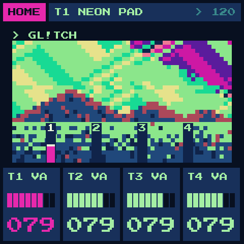
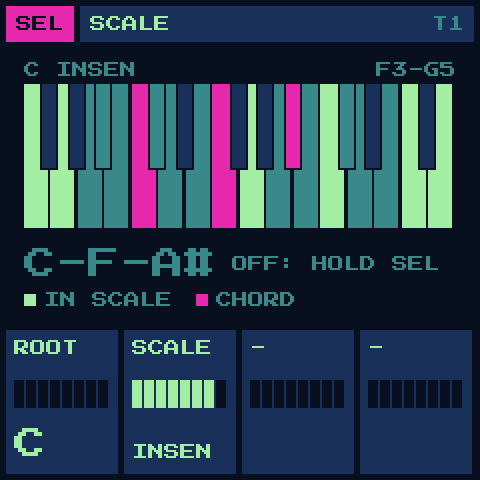
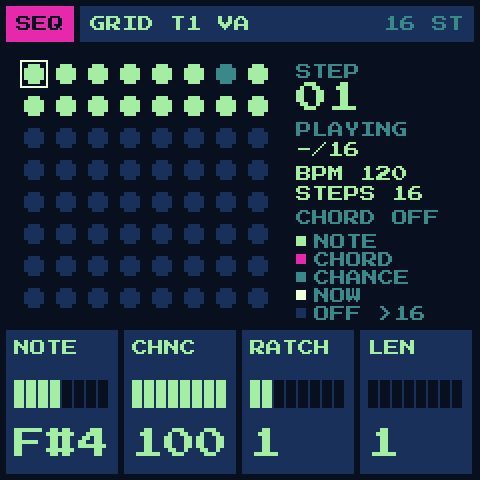
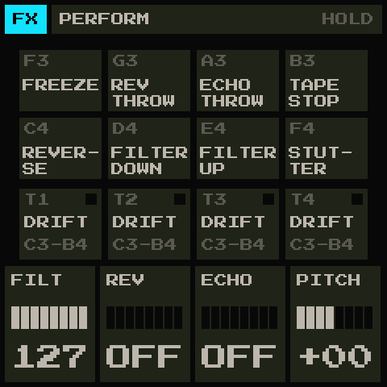

# GL!TCH — first steps

From switching it on to your first song, in about twenty minutes. Everything here works the same on a real FM-1 and in
the [web emulator](https://saulofilho.github.io/glitch/emu/). For every page and knob, see the [manual](../MANUAL.md).

---

## 0. Get it running

**In the browser (nothing to install):** open the [emulator](https://saulofilho.github.io/glitch/emu/), press
**Switch on**, wait for the boot screen to pass. Turn knobs by dragging or scrolling on them; play with the computer
keyboard:

| Computer keys | On the FM-1 |
|---|---|
| `Z X C V B N M , . /` | the white keys F3, G3, A3, B3, C4, D4, E4, F4, G4, A4 |
| `S D F H J L ; '` | the black keys F#3, G#3, A#3, C#4, D#4, F#4, G#4, A#4 |
| `Q W E R T Y U I O` | the upper keys, B4 to G5 |
| `1 2 3 4 5 6` | FX, SEL, ENV, LFO, EDIT, GLO |
| `7 8 9 0 - =` | HOME, SAVE, ARP, SEQ, PLAY/STOP, REC |
| `[` `]` | OCT− and OCT+ |
| `↑` `↓` / `←` `→` | SELECT / ALGORITHM |

To **hold** a button, keep its computer key down while you press the others (hold `1` and tap `Z` is "hold FX + F3").
The emulator is for trying things: don't count on it keeping your work.

**On the FM-1:** install it (see the [README](../README.md#install-on-the-fm-1)), switch on. At the first start the boot
screen may say `INSTALLING SAMPLES` for a few seconds. GL!TCH saves by itself whenever it is stopped and you have
left it alone for a moment.

---

## 1. Find your way around

You land on **HOME**: the glitched landscape, and the four tracks **T1–T4** as columns standing on its plain.

- **ALGORITHM** picks the track you work on. The header shows it and its sound: `T1 NEON PAD`.
- **PRESETS** loads the next or previous factory sound into that track. 44 sounds, by category: DRONE, PAD, BELL,
  VOICE, ORGAN, KEYS, OTHER, TEXTURE.
- **KNOB 1–4** always set the four values at the bottom of the screen. On HOME: VOLUME, CUTOFF, RESONANCE, FX.
- **Tap a button** to open its page, **tap it again** for its next page. The header says where you are (`SEL > CHORD`).
- **Undo:** hold **EDIT** + **OCT−**. Redo: hold **EDIT** + **OCT+**.

Try it: turn **PRESETS** slowly and play a few keys on each sound. Turn **KNOB 2** (CUTOFF) down and up while you
hold a note.

---

## 2. Pick a scale

So that every key you press fits, set a scale first. It is shared by all four tracks.

1. Tap **SEL**: the `SCALE` page.
2. **KNOB 1** = ROOT: turn it to **A**.
3. **KNOB 2** = SCALE: turn it to **INSEN** (dark, Japanese pentatonic) or **NOIR PENTATONIC**.

Now play any keys: they all snap to the scale. Nothing sounds wrong any more.

---

## 3. Your first song

Three tracks — a pad in chords, a lead pattern, a choir that plays itself — then the mix, and a slot to keep it. Tempo first: on HOME,
**SELECT** sets it (95 BPM is a good start).

### T1 — the pad

1. **ALGORITHM** to **T1**. Turn **PRESETS** to **NEON PAD**.
2. **Hold SEL and let go:** chord mode on for T1. One key now plays a whole chord of the scale.
3. Tap **SEQ**: the 64-step grid. Turn **SELECT** to step **01**.
4. Press **REC** (stopped). Each key you press now writes its chord into the selected step and moves to the next one.
5. Press **A3**, then move the cursor with **SELECT** to step **05** and press **F3**, step **09** press **G3**, step
   **13** press **E4**. Press **REC** again to stop recording.
6. On the grid, select each step you wrote and turn **KNOB 4** (LENGTH) up to **4**: each chord lasts until the next.

Press **PLAY**: four chords, looping over 16 steps.

### T2 — a lead that writes itself

1. **ALGORITHM** to **T2**. **PRESETS** to **GLITCH LEAD** (or **DATA PLUCK** for something drier).
2. Tap **SEQ**. **Hold SEQ** and press **G3**: RANDOM fills T2's pattern with notes of the scale.
3. Not quite it? **Hold SEQ + F4** (MUTATE) changes a few steps; **Hold SEQ + G3** again rolls a new one. Undo with
   **EDIT + OCT−**.
4. On a step you like less, turn **KNOB 2** (CHANCE) down: it plays only sometimes, so the line keeps changing.

### T3 — a choir that plays by itself

1. **ALGORITHM** to **T3**. **PRESETS** to **MEGACITY CHOIR**.
2. **Hold FX** and tap **A#3** (T3's black key): GENERATE. T3 now plays random notes of the scale by itself, slow and
   soft (DRIFT).
3. Want it busier? Keep holding FX, hold **A#3**, and tap **D#4**: DRIFT → PULSE → STORM.

### The mix

Back on **HOME** (tap **HOME**), for each track (**ALGORITHM**): **KNOB 1** = VOLUME, **KNOB 4** = FX (how much
delay, reverb and tape it gets). Tap **HOME** again for **MIXER 1**: **SELECT** moves between LEVEL, DELAY, REVERB,
TAPE, GRAIN and DRIVE; **KNOB 1** sets the one outlined.

A good start: the pad with a lot of REVERB, the lead with some DELAY, the choir quieter than both.

### Save it

**Hold SAVE** and press **C4**: your song is in slot **A**. (Already used? Press C4 again within 3 seconds to
overwrite.) Recall it any time with **hold SAVE + F3**. Make a variation, save it to **B** (hold SAVE + D4), and you
can switch between A and B while playing: the change lands on the next bar.

---

## 4. Play it live

**Hold FX** while the song plays: the PERFORM screen. Each trick lasts while you hold its key:

| F3 | G3 | A3 | B3 | C4 | D4 | E4 | F4 |
|---|---|---|---|---|---|---|---|
| FREEZE | REV THROW | ECHO THROW | TAPE STOP | REVERSE | FILTER DOWN | FILTER UP | STUTTER |

Try **TAPE STOP** at the end of a phrase, **ECHO THROW** on the last note of the lead, **FREEZE** (tap on, tap off) to
hold a cloud of sound while you change the pattern underneath.

**Mute and solo:** hold **GLO** + F3–B3 mutes T1–T4; hold **GLO** + C4–F4 solos them.

The landscape on HOME tears harder the louder it plays: the screen is part of the show.

---

## 5. Next steps

- **Make a sound of your own:** **EDIT** opens the track's sound. On the SOURCE page pick one of the seven engines
  (VA, FM, SAMPLE, VOICE, WHEEL, PHYS, PHASE), then turn the four knobs. **ENV** and **LFO** shape it. Save it with
  **SAVE → SOUNDS**. → [manual, §3](../MANUAL.md#3-sounds-edit)
- **A song from slots:** **GLO** opens SONG: chain slots A–D, each repeated, and play them in order.
  → [manual, §8](../MANUAL.md#8-slots-and-songs-save-glo)
- **Lock a sound to a step:** on the grid, hold **SEL** and turn a knob: that step gets its own value.
  → [manual, §7](../MANUAL.md#7-sequencer-seq-play-rec)
- **Your own samples, a backup:** the [editor](https://saulofilho.github.io/glitch/emu/editor.html) (Chrome or Edge,
  the FM-1 on USB). → [manual, §15](../MANUAL.md#15-the-editor)
- **Everything at once:** [the combos](../MANUAL.md#13-combos-at-a-glance).

---

## If something is off

| What you see | What it is |
|---|---|
| No sound | MASTER turned down, or the track's VOLUME (HOME, KNOB 1) at 0, or it is muted (hold GLO). |
| `CUT` under a track on HOME | Its filter is closed: turn CUTOFF (HOME, KNOB 2) up. |
| `DRY` under a track | Its FX (HOME, KNOB 4) is at 0: it gets no effects. |
| A note keeps sounding | The sound is latched: tap the key again, or hold **SEL + OCT+** to switch LATCH off. |
| A pattern you didn't want | Undo: hold **EDIT + OCT−**. Hold **REC** (~1 s) clears the track's whole pattern. |
| `SAVES WHEN SILENT` | It waits for the sound to stop to save. Stop the sequencer. |
